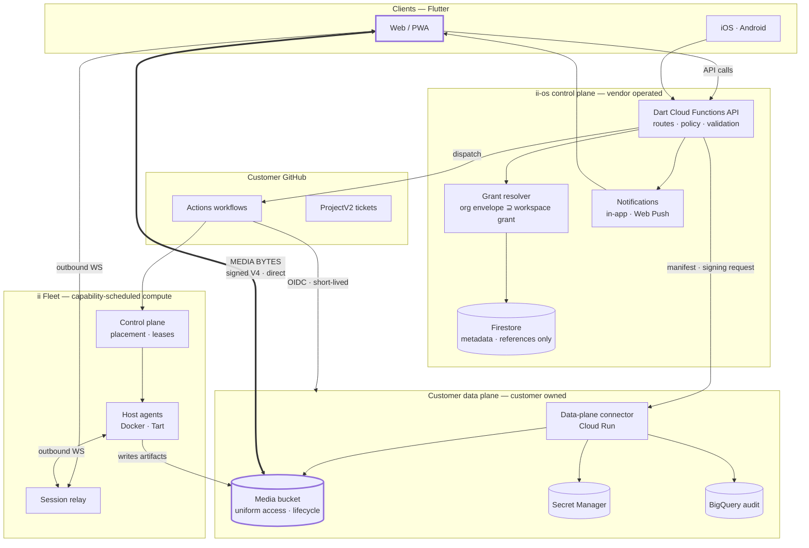

# ii-open-os

[](#status)
[](https://opensource.org/licenses/Apache-2.0)
[](https://flutter.dev/)
[](https://dart.dev/)
[](https://cloud.google.com/)

**A control plane for AI generation and agent work that never holds your bytes or your
keys.** Organizations bring their own cloud project. ii-os orchestrates jobs, enforces
permission envelopes, and writes the audit trail — while generated media moves directly
between the customer's browser and the customer's own storage.

> ### Status
>
> **This repository is a preview.** No source is published here yet — this README is the
> architecture of a system already running privately, written up ahead of the open-source
> release. It documents design and rationale, not a runnable build. Watch the repo for the
> first code drop.

---

## The problem

A hosted AI media platform normally ends up custodian of everything: customer prompts,
generated video, cloud credentials, and the compute that produced them. That is the easy
architecture and the wrong one. It makes the vendor a single point of compromise, it makes
data residency someone else's promise, and it makes cost and egress opaque to the customer
paying for it.

ii-os inverts the ownership. The **customer owns the data plane** — the storage bucket, the
secrets, the audit dataset, the service account, and the runners. ii-os owns only the
**control plane**: who may do what, which job was dispatched, and what verifiably came back.

The design constraint that shapes everything below: *generated bytes and long-lived
credentials must never transit the control plane.*

---

## Architecture



The thick edge is the whole point: media bytes have exactly one path, and it does not touch
the vendor.

---

## Design pillars

### 1. Customer-owned data plane

Onboarding provisions, inside the customer's own GCP project, a media bucket with uniform
access and a lifecycle policy, a single least-privilege service account, a partitioned
BigQuery audit table, named Secret Manager entries, and a GitHub OIDC workload identity
pool bound to the exact repository, ref, and workflow path.

ii-os receives one thing: the HTTPS URL of a **data-plane connector** deployed into that
project. The connector is the narrow server-side boundary that validates manifests, verifies
object metadata, and signs short-lived browser URLs. No service-account JSON key ever
reaches GitHub Actions, the browser, or the vendor.

### 2. Every byte is bound before it is trusted

Media handling is capability-based in both directions, and both directions verify.

| | Read | Write |
| --- | --- | --- |
| Grant | Signed V4 read URL | Signed V4 write grant |
| Bound to | Workspace, job, bucket, object generation, expiry, byte length, SHA-256, content type, media signature | Workspace, bucket, exact object, expiry, content type, SHA-256, CRC32C |
| Enforced by | Client decodes only verified local, blob, or disposable-file bytes | Immutable-generation precondition + server-side checksum validation |
| Recorded | — | Control plane stores verified object metadata and a reference, never the bytes |

A grant that does not match its manifest is not a degraded read. It is a refusal.

### 3. Grants narrow, never widen

An **organization** is the tenant. It owns bounded catalogs of cloud projects, GitHub App
installations, repository and permission envelopes, and runner pools. A **workspace** is a
project inside that tenant.

A new workspace starts empty — and empty means *no access*, never "inherit everything."
An Organization Admin adds resources to the catalog; a Workspace Admin selects an explicit
subset. Every permission, repository name, runner capability, CPU limit, RAM limit, and
concurrency cap is transactionally checked as a **subset of the current organization
envelope**. Shrinking an organization resource can make a workspace grant stale; nothing
can make it wider.

Staleness is resolved at the moment of use — before loading a key, minting a token, reading
or writing an asset, uploading an artifact, or dispatching a job.

| Role | Scope |
| --- | --- |
| Organization Admin | Membership, workspaces, cloud and GitHub resources, runner pools, audit state |
| Workspace Admin | One workspace; may *narrow* its grants, never add or widen an organization resource |
| Member | Only the workspaces they hold an explicit grant to |

### 4. Compute is placed, leased, and proven clean

Jobs run on [**ii-fleet-runner**](https://github.com/intelligent-iterations/ii-fleet-runner) —
an open-source Go control plane and host agent that places work by capability and capacity,
admits it against host-side RAM/CPU/disk limits, runs it in a Docker container or Tart VM,
records an append-only audit stream, and **requires cleanup proof before returning
capacity**. Nothing executes directly on a persistent host.

Runner capacity is derived from a fresh, organization-scoped provider attestation rather
than from a cloud credential — a conservative envelope over non-draining hosts. Capacity
sync reads; it never registers or creates a host.

### 5. Humans deploy agents; schedulers do not

The agent workshop has no ticket poller and no background scheduler. A workspace member
presses **Deploy** on exactly one project ticket. That request validates a structured
Definition of Done, test instructions, the branch-installed permission profile, agent
readiness, and an allowlisted workflow — then freezes a one-use approval, claims it, writes
an audit receipt, and dispatches that exact workflow before the request returns.

The ticket stays in `Todo` until an authoritative Fleet callback moves it to `In Progress`.
If the agent hits a human-only blocker, it comments the question on the source issue and
moves the item to `Needs Human Input`; a human answer is required, published back as a
comment, and the ticket returns to `Todo` for another deliberate pass.

The control plane never executes the agent and never receives the execution secrets.

### 6. Local-first media editing

A multi-lane editor for video, audio, and caption tracks runs **on the user's device** —
WebAssembly FFmpeg in the browser, native FFmpeg on mobile — via the sibling
`ii-ffmpeg-universal` and `ii-flutter-video-editor` packages.

It imports bounded MP4, WebM, JPEG, PNG, WebP, MP3, WAV, and FLAC media; still images become
timed video layers locally. It supports clip splitting, text and subtitle overlays, and
bitrate selection, then renders browser-playable WebM on web or MP4 on mobile and uploads
the result straight to the customer bucket under a verified write grant.

The preview pane doubles as the operation-status surface: local render progress, upload
progress, the finished video, or an in-place failure with independent render and upload
retry. Renders are cancellable, and the engine survives cancellation to run again.

### 7. Interactive sessions without inbound access

Terminal sessions never SSH from the browser. Fleet places one disposable container in an
exact organization pool, and **both the runtime supervisor and every participant dial out**
to a session relay over WebSocket — no inbound ports, no host credentials in the browser.

Many participants may observe; exactly one input-lease holder may type, and the lease can be
handed off or revoked. Every attach grant is one-use and bound to session, role, generation,
policy, and expiry. An agent may be granted observe-only or observe-and-act access to the
live frontend, which publishes a bounded semantic snapshot — screenshots and sensitive
actions require a fresh human approval.

No background browser listener, snapshot subscription, or passive refresh is permitted.
Updates arrive on the already-open, user-initiated socket.

### 8. Prompt enhancement that cannot leak or fail loudly

Workspace admins may opt in to model-aware prompt rewriting. A pasted provider key is
AES-GCM sealed under a dedicated key-encryption key in a credential-only collection; the
workspace document exposes only *whether* a key exists and its last four characters.
Admins may instead name a Secret Manager version and grant the function identity access to
that external secret — the vendor never holds the material.

Before dispatch, the prompt is rewritten against the target model family's reusable guide
(Qwen, FLUX, Z-Image, inpainting, with a defined fallback), receiving only the request type
and attached-image count as context. **Image bytes and URLs are never sent to the enhancer.**
Disabled configuration, secret-access failure, provider failure, and malformed responses all
degrade to the same outcome: the user's original prompt, unchanged.

### 9. Cost is a first-class, honest number

Usage reporting reads normalized daily aggregates from the customer's BigQuery table and
copies **no prompt or transcript content** into the control plane. Queries are workspace-
scoped with a fixed result limit, timeout, and maximum bytes billed. Execution origin is
declared by the telemetry producer and never inferred from host, IP, or model.

The report refuses to conflate three different things:

- **API-equivalent cost** — what the captured tokens would cost at configured public rates.
- **Actual variable spend** — zero for subscription-included calls, metered cost for direct
  API calls, or explicitly marked incomplete when the true charge is unknown.
- **Monthly subscriptions** — fixed per-provider fees, reported separately.

The same discipline applies to the client: polling is governed by an explicit cost policy,
lists refresh when a user asks rather than on a live subscription, and the read-heavy
patterns that make serverless databases expensive are structurally unavailable.

---

## Repository shape

```
lib/                    Flutter client — web, iOS, Android
  screens/                layout and composition only
  widgets/                reusable, data-in / callbacks-out
  view_models/            busy, error, polling, selection state
  repositories/           API access, parsing, typed models
  theme/                  the only place raw numbers live
functions/              Dart Cloud Functions — the control-plane API
  lib/src/                routes, stores, grant resolution, verifiers
  test/ · tool/           unit tests and Firebase-emulator smoke runs
packages/
  ii_os_design_system/    tokens, themes, foundations, components
  ii_interactive_sessions/  session protocol + Flutter bindings
  ii_ui_mcp/              MCP surface for agent-driven UI inspection
services/
  ii_session_relay/       WebSocket relay for interactive sessions
  ii_interactive_runtime/  disposable session container image
```

**Dependencies point one way.** A screen may know its ViewModel; a ViewModel may know its
repositories; a repository knows the API client. Nothing points back up, and a shared widget
knows none of them — it takes values and callbacks, so it can be reused, previewed, and
golden-tested in isolation. This layering replaced an audited state where pages fetched
their own data, spacing constants were re-derived per file, and independent timers polled
the same endpoint.

---

## Stack

| Layer | Choice | Why |
| --- | --- | --- |
| Client | Flutter — web, iOS, Android | One codebase across three targets, with real native FFmpeg where it matters |
| Client architecture | Screens / widgets / view-models / repositories | Enforced one-way layering; design tokens centralized |
| API | Dart Cloud Functions | Shares models and validation with the client — one language, one contract |
| Metadata | Firestore | References and policy only; never media |
| Media | Customer-owned GCS, signed V4 URLs | Bytes stay in the customer's project and billing account |
| Secrets | Customer-owned Secret Manager, AES-GCM sealing | Vendor holds references, not material |
| Audit | Customer-owned BigQuery, partitioned | Customer can query and retain their own trail |
| Identity | Firebase Auth, passwordless, Google and Apple sign-in | Standard flows, no password custody |
| CI / dispatch | Customer GitHub Actions + OIDC | Short-lived cloud credentials; no long-lived keys |
| Compute | ii-fleet-runner — Docker and Tart | Capability placement, leases, cleanup proof |
| Media engine | FFmpeg — WebAssembly and native | Rendering on the device that owns the bytes |
| Testing | Unit, Firebase-emulator smoke, golden, on-device integration | Real emulators and real devices, not mocks of them |

---

## Roadmap to open source

- [ ] **M1 — Extraction** · Split the vendor-neutral control plane from private deployment wiring
- [ ] **M2 — Reference data plane** · Publish the connector and provisioning scripts as a runnable template
- [ ] **M3 — Grants & audit** · Organization/workspace envelope model, resolver, and audit contract
- [ ] **M4 — Verified media path** · Signed read/write grant libraries with conformance tests
- [ ] **M5 — Editor** · Local-first multi-lane editor on the universal FFmpeg runtime
- [ ] **M6 — Sessions** · Relay, disposable runtime, and lease-based input control
- [ ] **M7 — Agent workshop** · Human-deployed agent dispatch with one-use approvals
- [ ] **M8 — Docs** · Threat model, deployment guide, and a self-host quickstart

---

## Related open-source work

- [**ii-fleet-runner**](https://github.com/intelligent-iterations/ii-fleet-runner) — capability-scheduled ephemeral compute across Docker and Tart
- [**ii-queue-runner**](https://github.com/intelligent-iterations/ii-queue-runner) — self-hosted GitHub Actions on Apple Silicon
- [**ii-llm-lab**](https://github.com/intelligent-iterations/ii-llm-lab) — evaluation-driven lab for LLM agents
- [**ii-agent-harness**](https://github.com/intelligent-iterations/ii-agent-harness) — agent sessions with a Slack bridge

## License

[Apache License 2.0](LICENSE)
